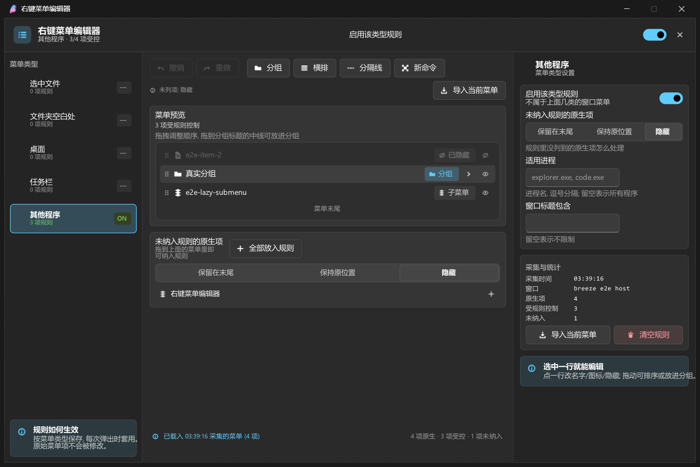

# 右键菜单编辑器

breeze-shell 的可视化右键菜单编辑器：把真实弹出的右键菜单采集下来，用拖拽的方式重排、分组、改名、换图标、隐藏，
再按 **菜单类型** 分别保存成规则，每次菜单弹出时自动套用。

TypeScript + React（breeze 的内置渲染器）+ Fluent Design，构建产物是单文件插件 `plugins/context-menu-editor.js`。



## 功能

| 能力 | 说明 |
| --- | --- |
| 拖拽排序 | 抓住任意一行拖动，行与行之间显示插入线 |
| 分组 | 两种布局：**分组**（收进子菜单）与**横排**（子项排成一行按钮） |
| 拖进 / 拖出分组 | 拖到分组标题的中线上放入分组；拖到「未纳入规则」区域把项移出规则 |
| 新建分组 | 工具栏「分组 / 横排」；也可以把选中项一键收纳进新分组 |
| 重命名 | 右侧检查器改显示名，留空则沿用原生名称（含本地化名称） |
| 赋图标 | 38 个内置 Fluent 图标 + 自定义 SVG + 「原生图标」/「无图标」 |
| 隐藏 / 显示 | 单行眼睛按钮或检查器开关；隐藏项在编辑器里半透明显示，方便随时恢复 |
| 禁用 | 置灰不可点（原生已禁用的项始终禁用） |
| 分隔线 | 任意位置插入，自动清理开头/结尾/连续的分隔线 |
| 自定义命令 | 新建菜单项：运行/打开路径（支持 `%PATH%` / `%FOLDER%`）或复制文本 |
| 按类型生效 | 选中文件 / 文件夹空白处 / 桌面 / 任务栏 / 其他程序，各存一份规则 |
| 其他程序过滤 | 「其他程序」可以按进程名与窗口标题过滤 |
| 未列项策略 | 未纳入规则的原生项：保留在末尾 / 保持原位置 / 隐藏 |
| 撤销重做 | 40 步历史，跨菜单类型 |
| 导入当前菜单 | 一键把采集到的菜单全部纳入规则，作为编辑起点 |

## 使用流程

1. 右键打开一次要编辑的菜单（例如在文件上右键）。这一步会被插件采集下来。
2. 菜单里点 **右键菜单编辑器 ▸ 编辑这个菜单…**（或先打开编辑器，再从左侧选类型）。
3. 工具栏点 **导入当前菜单** 把原生项变成可编辑的规则行。
4. 拖动、分组、改名、换图标。
5. 打开顶部的 **启用该类型规则** 开关。
6. 之后再打开这个菜单，就会按规则呈现。

规则只描述「怎么改」，不改动原生菜单本身；关掉开关即可恢复原样。

## 工作原理

```
弹出右键菜单
   │
   ├─ captureMenu()     读 ctx.menu.items 的 data()，得到 {名字, 图标, 禁用, 子菜单, wID, 资源ID, 快捷键}
   │                    └─ 存成 snapshot（只有元数据，供编辑器显示）
   │
   ├─ classifyMenu()    由 js_menu_context 判断菜单类型
   │
   ├─ planMenu()        规则 nodes × 采集到的项 → 计划树 PlanNode
   │                    按 ref.key 匹配；未被规则覆盖的项按「未列项策略」放置
   │
   └─ appendPlan()      menu.clear() 后按计划重建菜单
                       ├─ 普通项：用捕获到的 js_menu_data 重建（action / submenu 闭包原样带过去）
                       ├─ 横排组：append_parent_item() + append_child()
                       └─ 分组：append_item({ submenu }) 里递归重建
```

重建之所以是无损的：`menu_item_controller.data()` 会把原生项的 `action`（内部就是
`selected_menu = wID` + 关闭菜单）和 `submenu` 闭包原样暴露给 JS，所以把捕获到的数据
重新 `append_item` 出来的项，点击后依然执行原来那条原生命令，子菜单也依然由原生 HMENU 填充。

### 匹配键

原生项按下面的优先级生成稳定的匹配键，保证换语言、换菜单顺序后规则依然对得上：

```
name_resid（资源串 ID，语言无关） > origin_name（原始文本，含 & 与 \t） > name（显示文本）
重复的名字按出现次序追加 #1 / #2
```

编辑器右侧「原生匹配信息」会把 `wID` / 资源 ID / 原始文本 / 快捷键都显示出来，方便排查规则没生效的原因。

## 目录

```
context-menu-editor/
├─ build.mjs          esbuild 构建脚本, 产出 ../context-menu-editor.js
├─ src/
│  ├─ index.tsx       插件入口: 菜单监听、采集、应用规则、菜单里的入口
│  ├─ plan.ts         采集 / 匹配 / 计划 / 重建 (与 UI 无关, 可单测)
│  ├─ model.ts        规则树的纯函数操作 (移动/分组/复制/规范化)
│  ├─ settings.ts     配置读写与严格校验 (手改坏的 config.json 也能兜住)
│  ├─ types.ts        规则与设置的模型类型
│  ├─ app.tsx         编辑器窗口 (三栏 + 拖拽 + 检查器 + 图标选择)
│  ├─ ui.tsx          Fluent Design 组件集 (自绘, 与 shell 内置配置页同一套 token)
│  ├─ theme.ts        主题 token 与内置图标
│  ├─ window.ts       插件窗口生命周期
│  └─ i18n.ts         zh-CN / en-US
├─ test/              node 单测 + 真实 shell.dll 沙箱 e2e
└─ docs/             截图
```

## 开发

```powershell
cd plugins/context-menu-editor
npm install
npm run typecheck      # tsc --noEmit
npm run build          # 产出 ../context-menu-editor.js
npm test               # node 单测 (无 shell, 用 mshell stub)
npm run e2e            # 真实 shell.dll + 真实 TrackPopupMenuEx
```

e2e 需要先在 devenv 根目录跑过一次 `.\e2e\run.ps1`（它会编译宿主进程），并且被测 shell 是
`.work\ctx-menu-editor\breeze-shell` 那套构建产物（见根目录 `README.md` 的 worktree 流程）。

`test/sandbox-e2e.ps1` 一共跑三段，每段都把插件与探针拷进沙箱 home，再启动真实的
`explorer.exe` 宿主进程（真实 `TrackPopupMenuEx`）：

| 段 | 场景 | 验证内容 |
| --- | --- | --- |
| 1 | `menu` | 采集真实原生菜单；规则未启用时菜单原样不动；用合成菜单验证规则重建（顺序/改名/图标/横排/隐藏），以及重建后的项仍保留 `wID`/资源 ID/原始文本/快捷键/位图图标并能触发原动作 |
| 2 | `menu` | 把规则作用在**真实原生菜单**上，断言重排、收纳进分组、图标与命令 id 保留 |
| 3 | `js-interact` | 打开编辑器窗口，宿主截图到 `docs/window-preview.png` |

第 2 段会改掉宿主那份菜单，破坏 harness 自己针对该场景的断言，所以单独跑一段，只看探针结果。

## 用这套插件检验插件系统 / GUI 系统时发现的问题

写这个插件的过程本身就是为了体检，下面是实际撞到并处理过的问题：

**已在本仓库修掉（`breeze-shell` worktree `ctx-menu-editor`）**

1. `js_menu_data` 缺 `hotkey`：原生项的快捷键提示（`item.hotkey`）无法被插件读到，任何被插件
   重建的项都会丢掉快捷键显示。已给 `js_menu_data` 加上只读的 `hotkey` 字段。
2. `to_menu_item()` 不写回 `wID` / `name_resid` / `origin_name`：插件新建或重建的项会变成
   「身份不明」，排在它后面的插件（例如 `contextmenu-cleaner` 按 `origin_name` 匹配）就认不出它了。
   已改为传入即写回，重建后的项保留完整身份。
3. `menu_item_controller` 看不到水平菜单母项里的子项（`menu_controller.items` 只返回普通项的包装），
   插件读不到自己刚建出来的横排组。已补 `menu_item_controller.children()`。
4. React 渲染器把值为 `undefined` 的属性直接打给原生 setter：`backgroundColor={hover ? a : undefined}`
   这种很常见的 JSX 写法会让颜色 setter 拿到 `undefined` 并抛
   `cannot read property 'startsWith' of undefined`，整个窗口渲染不出来。已改为跳过 `undefined`
   （`createInstance` / `commitUpdate` / 颜色 setter 三处）。
5. `cursor` 属性只在 C++ 侧暴露、React 渲染器里没有映射（现在已由 294e032 补上，本插件直接用了）。

**还在的缺口（建议后续补）**

1. **`flex` / 通用 widget 没有 `on_key_down`**：`widget::handle_key` 存在，`dispatch_key` 也会把
   按键广播给所有 widget，但绑定里只有 `textbox` 暴露了 `onKeyDown`，所以插件窗口做不了
   Ctrl+Z / Delete 这类快捷键（只能靠按钮）。本插件因此把每个操作都做成了可见按钮。
2. **容器没有滚动位置 API**：`breeze-ui` 的 `flex_widget::scroll_top` 没有暴露，插件无法
   程序化滚动（拖拽到边缘自动滚动、滚动到选中项都做不了）。
3. **`js_widget` 没有 `visible`**：隐藏一个子 widget 只能靠 React 卸载重建，会丢掉状态；
   `visible` 传进 C++ 能省掉不少重建。拖拽时的浮层也受影响。
4. **没有「把已有项移动到别的父容器」的 API**：`menu_item_parent_item_controller` 只有
   `append_child(data)`（新建），没有 `adopt(child, index)`。本插件靠「读 `data()` → `remove()` →
   `append_item`」重建，能用且无损，但多一次删除+新建；如果以后要保留 widget 身份，建议补一个
   `menu_item_controller.move_to(parent, index)`。
5. **菜单只能在弹出瞬间读取**：没有任何 API 能在菜单没打开时枚举一个菜单，所以「编辑器里预览真实菜单」
   只能靠「上次弹出时采集的快照」。本插件把采集做成弹菜单时的副作用，并在菜单里放了一个
   「导入当前菜单」入口来弥补。
6. **插件窗口不能改大小/位置**：`breeze_ui.window` 只有 `create` / `create_ex` / `close`，
   编辑器窗口尺寸只能写死。
7. **文本没有省略号、flex 行不能换行**：长菜单名只能插件自己按字数截断。

## 许可

与 breeze-shell 一致（GPL-3.0）。
