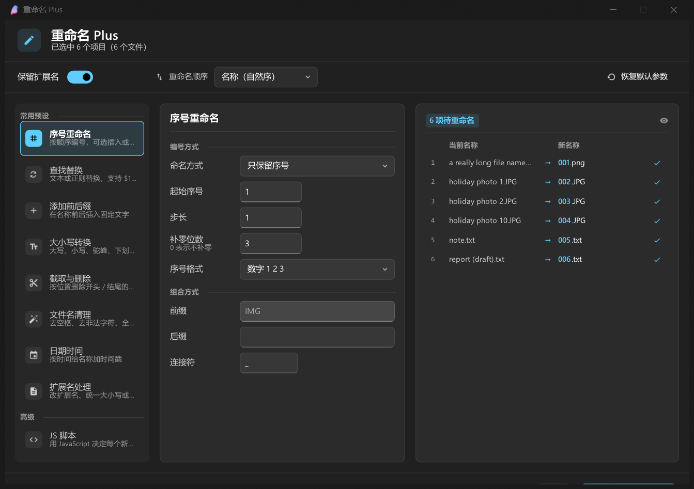
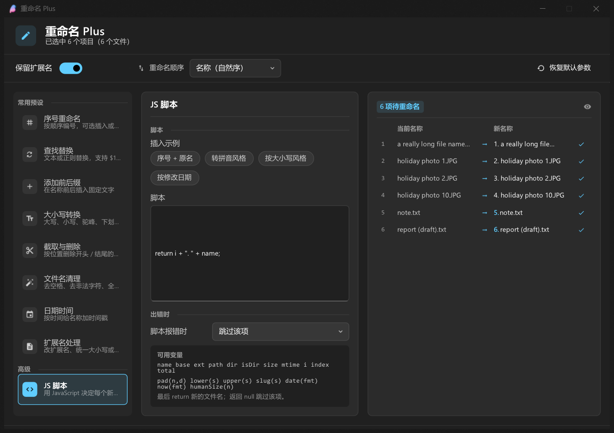
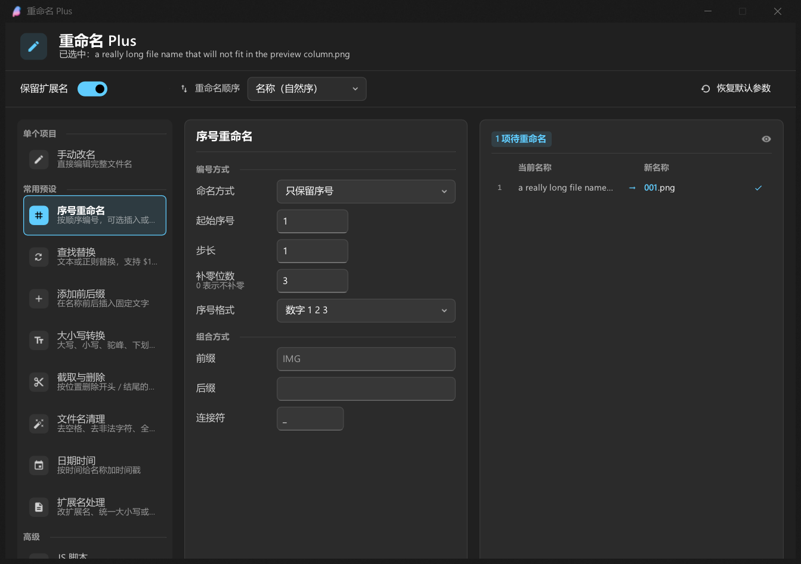
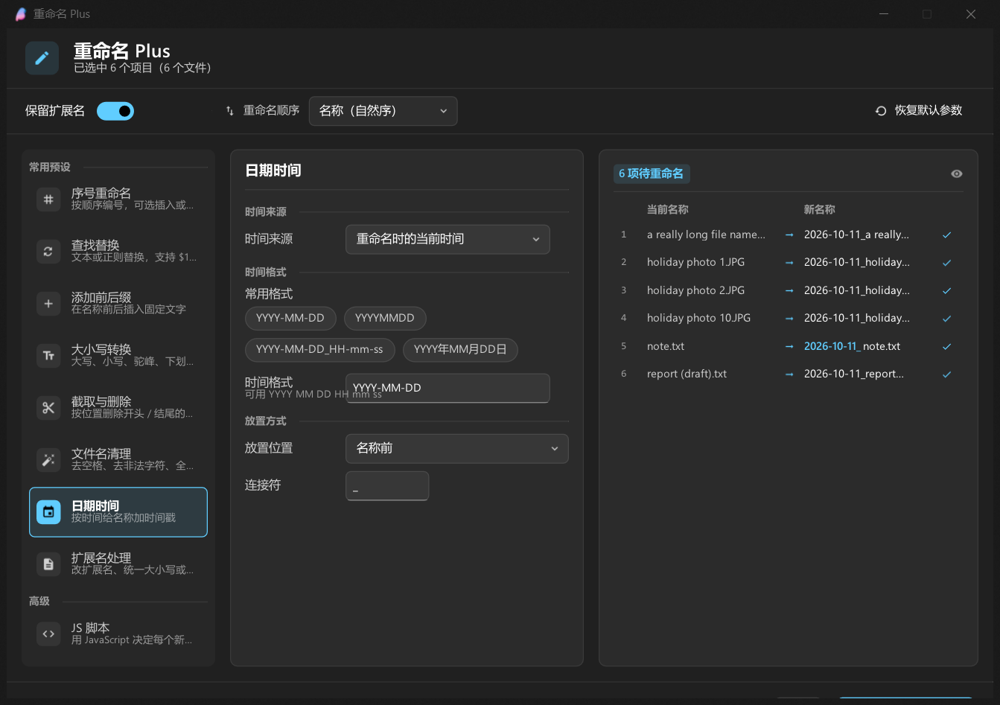

# 重命名 Plus

breeze-shell 的批量重命名插件：右键菜单选一个预设直接改，或者打开窗口细调、写 JS 脚本决定新名字，改之前能看到每一项的「原名 → 新名字」。

TypeScript + React 写成，界面用 Fluent Design 的那套色板/控件（跟 breeze 自带的设置页同一套视觉语言）。



窗口分三栏：左边挑预设，中间按「编号方式 / 组合方式」这种小节分组调参数，右边逐项列出「原名 → 新名字」并高亮改动的那几个字。顶部工具栏放全局开关（保留扩展名、重命名顺序、恢复默认参数），底部状态条给冲突提示和「应用」。

| JS 脚本 | 单选（手动改名） | 日期时间 |
| --- | --- | --- |
|  |  |  |

## 功能

- **单选 / 多选** 都能用：单选时窗口顶部多一组「手动改名」，直接编辑完整文件名；多选时按顺序批量处理。
- **8 个常用预设**：序号、查找替换、添加前后缀、大小写转换、截取与删除、文件名清理、日期时间、扩展名处理。
- **JS 脚本**（高级）：用 JavaScript 决定每一项的新名字，附带插入示例、可用变量说明和语法错误提示。
- **实时预览**：右侧逐项列出「原名 → 新名字」，改动的部分高亮；冲突/非法名称就地标红并说明原因。
- **冲突保护**：批量内重名、目标已存在、非法字符、系统保留名、结尾空格/点、路径过长都会拦下来；改名走两阶段（先临时名再落地），不会互相覆盖。
- **可撤销**：应用之后窗口里有「撤销」，右键菜单里也有「撤销上次重命名」，记录会存进插件配置，重启资源管理器之后仍然可用。
- **键盘可用**：焦点不在输入框时 <kbd>Esc</kbd> 关窗、<kbd>Enter</kbd> 应用、<kbd>↑</kbd><kbd>↓</kbd> 换预设；数字输入框点进去就全选（直接覆盖输新值），<kbd>↑</kbd><kbd>↓</kbd> 加减、<kbd>Enter</kbd> 提交、<kbd>Esc</kbd> 撤销输入。
- 中英双语（跟随 breeze 的语言设置），深浅色主题跟随系统。

## 目录

```
plugins/
├─ rename-plus/            <- 源码（本目录）
│  ├─ src/                 # TS/React 源码
│  ├─ test/                # 逻辑测试 + 沙箱 e2e
│  ├─ build.mjs            # esbuild 打包脚本
│  └─ package.json
└─ rename-plus.js          <- 构建产物，breeze 真正加载的那个文件
```

breeze-shell 的插件加载器只扫脚本目录里的 `*.js` 单文件，所以源码放在 `rename-plus/`，产物是同级目录的 `rename-plus.js`。

## 开发

```powershell
cd plugins/rename-plus
npm install
npm run build        # 打包成 plugins/rename-plus.js
npm run watch        # 改一行自动重打
npm run typecheck    # tsc --noEmit
npm test             # 纯逻辑测试（node + mshell 替身，95 条断言）
npm run e2e          # 沙箱 e2e（真实 shell.dll + 真实 QuickJS + 窗口截图）
```

`npm run e2e` 需要先在仓库根目录跑过一次 `.\e2e\run.ps1`（它会编译那个 explorer.exe 宿主进程）。e2e 会在 `.work\_default\home` 这个沙箱里装好插件，让探针在**真实的 QuickJS 运行时**里建测试文件、跑预设、撤销、打开窗口，最后给窗口截图（`out/js-window.png`）。shell.dll 来自某个 worktree 时，加 `-Worktree <名字>` 就会用那套构建（沙箱目录也跟着变成 `.work\<名字>`）。

## 8 个预设

| 预设 | 做什么 | 主要参数 |
| --- | --- | --- |
| 序号重命名 | 按顺序编号，可替换原名或插到前/后 | 起始值、步长、补零位数、数字/字母、前缀后缀、连接符 |
| 查找替换 | 文本或正则替换，支持 `$1` 捕获组 | 查找、替换为、匹配方式、区分大小写 |
| 添加前后缀 | 在名字前后插入固定文字 | 前缀、后缀、连接符 |
| 大小写转换 | 全大写/全小写/词首大写/驼峰/下划线/连字符/反转 | 转换方式 |
| 截取与删除 | 按位置删开头、结尾的字符，或只保留某一段 | 处理方式、起止位置 |
| 文件名清理 | 去首尾空格、合并空格、删非法字符、全角转半角、去重复分隔符 | 5 个开关 + 2 个下拉 |
| 日期时间 | 加时间戳：当前时间 / 文件修改时间 / 指定起始时间递增 | 时间格式（YYYY MM DD HH mm ss）、位置、递增步长 |
| 扩展名处理 | 改扩展名、统一大小写、补上或删掉扩展名 | 处理方式、新扩展名 |

工具栏上的「保留扩展名」是全局开关：打开时预设只改主文件名（扩展名原样保留），关掉时预设会把扩展名当成名字的一部分一起处理。

## JS 脚本

脚本对每一项执行一次，`return` 新的文件名（含扩展名）；返回 `null`/`undefined`/`false` 表示跳过这一项。

可直接使用的变量：

```
name  base  ext  path  dir  isDir  size  mtime  i  index  total
```

以及几个小工具：`pad(n, d)`、`lower(s)`、`upper(s)`、`slug(s)`、`date(fmt)`（有文件修改时间就用它，否则用当前时间）、`now(fmt)`、`humanSize(n)`。

```js
// 序号 + 原名            -> "1. holiday photo.JPG"
return i + ". " + name;

// 转成 slug 风格          -> "holiday-photo.jpg"
return slug(base) + ext;

// 按大小打标签            -> "large-holiday.jpg"
const tag = size > 1024 * 1024 ? "large" : "small";
return tag + "-" + base + ext;

// 按修改日期              -> "2026-01-02_holiday.jpg"
return date("YYYY-MM-DD") + "_" + name;
```

脚本在界面线程同步执行（QuickJS 里没有 worker），写的时候别放死循环。

## 实现上的几个取舍

- **不用 breeze 的 toast 接口**：`notification.*` 在插件的脚本线程上调用会让宿主进程堆损坏（沙箱 e2e 里稳定复现 `0xC0000374`），所以结果只写日志，反馈交给菜单里的「撤销上次重命名」和窗口里的状态条。
- **文件修改时间**：breeze 没有暴露文件时间接口，选「文件修改时间」时才会用一次 `powershell -EncodedCommand`（带 `-WindowStyle Hidden`）批量取时间，其余情况完全不用外部进程。
- **冲突检查**：`std::filesystem::rename` 在 Windows 上会覆盖同名目标，所以每次改名之前都会再确认目标没被占用；批量内部互相占位（比如 a↔b 互换）时先全部改成临时名再落地，中途出错会把已改的还原回去。
- **数值属性传 `undefined` 会让宿主卡死**：`lineHeight={undefined}` 这类写法会把 0 以外的垃圾值写进 widget（NaN），文本测量一返回 NaN，Yoga 每帧都打一条错误日志，日志把宿主的标准输出管道写满之后整个界面就停在那里了。现在两边都堵上了：插件的 `Text` 只在真有值时才传这个属性，bindgen 生成的数值 setter 也会挡掉 NaN/∞。
- **固定列宽的面板要显式写宽度**：文本的 `maxWidth` 会算进父容器的 max-content，参数栏里一行长文本就足以把右边预览栏挤出去。现在三栏都按窗口宽度算好固定宽度，长文本自己换行（`minWidth={0}` + `flexWrap="wrap"`）。
- **类型声明**：`src/types/` 里自带一份 mshell 子集声明（官方 npm 包 `breeze-shell-types` 目前落后于运行时，缺 `js_textbox_widget` 等）。
- **React 实例**：必须复用 breeze 内置脚本挂在 `globalThis` 上的那一份 React（`src/react.ts`），自己打包一份会触发 `Invalid hook call`。

## 许可证

与 breeze-shell/plugins 仓库一致。
